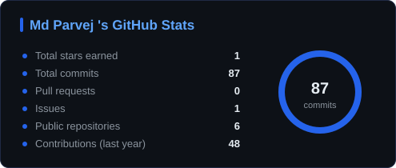
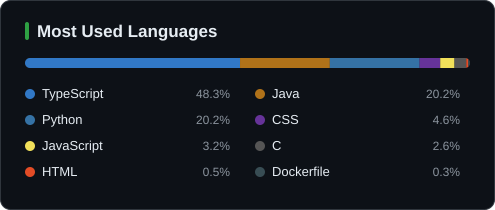
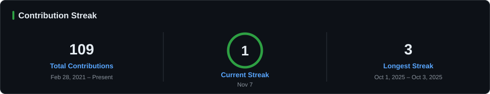
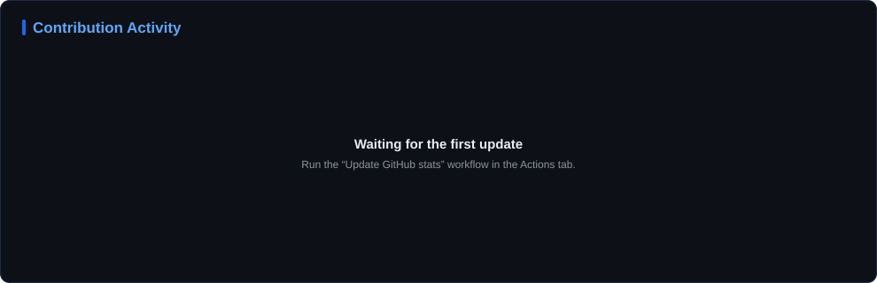
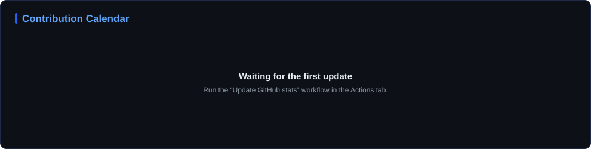

<!--
  The stats images in stats/ are regenerated daily by .github/workflows/update-stats.yml.
  Links not added yet (Portfolio, WhatsApp, competitive programming) are kept below inside
  HTML comments: fill in the ALL_CAPS placeholder and remove the comment markers to show them.
-->

<h2 align="center">Hi, I'm Md Parvej</h2>

  <b>Undergraduate CSE Student | Software Developer</b>

  I'm an undergraduate Computer Science &amp; Engineering student who enjoys turning ideas into working software.
  I build for the web and beyond with C++, Python, Java and JavaScript, and frameworks like React, Next.js, Laravel and Django.
  I'm always learning and open to collaborating on interesting projects.

---

## Connect with me

  
  
  
  <!-- Add later: remove these comment markers and fill in the URL / number.
  
  
  -->

---

## Languages

  
  

## Tools & IDEs

  
   
  

## Frameworks & Libraries

  

---

## GitHub Statistics

  
  

  

  

  

Generated daily from the GitHub API by a GitHub Actions workflow in this repository.

<!-- Add later: competitive programming profiles. Fill in your handles, keep the badges you
     need, then remove the comment markers (this line and the closing one below).

---

## Competitive Programming

  
  
  
  
  
  
  

-->

---

  <b>Thanks for visiting my profile. Let's connect and collaborate!</b>

